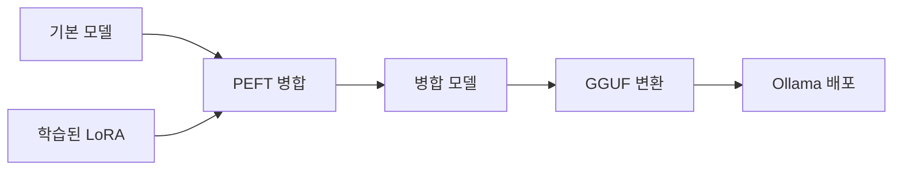

# 📘 11차시 | 모델 병합·GGUF·Ollama 배포

**60분 실습 / 2026-11-05 공식 자료 확인 / Qwen2.5-0.5B-Instruct는 교육용 제작 선택**

## 1. 표지·목표·60분 운영

이번 차시는 09·10차시에서 학습된 LoRA 어댑터를 독립 실행 가능한 모델로 만드는 배포 과정이다. 0~10분 개념, 10~20분 병합 준비, 20~35분 코드 점검·병합, 35~45분 GGUF 변환, 45~55분 Ollama 실행, 55~60분 평가로 운영한다. 실제 학습 완료 어댑터가 없으면 검증 전용 실습만 수행한다.

## 2. 배경·선수지식

09차시 SFT+LoRA는 기본 가중치와 학습된 저랭크 행렬을 분리 저장한다. 10차시 QLoRA는 학습 중 기본 가중치를 4비트로 적재하지만 배포 단계에서는 별도 비양자화 기본 모델에 어댑터를 적용하는 경로를 권장한다. 반드시 같은 베이스 모델과 토크나이저를 사용한다.

## 3. 핵심 원리: 병합

LoRA의 학습된 변화량은 ΔW = (α/r)BA이며, 병합 가중치는 W' = W + ΔW로 설명한다. merge_and_unload()의 반환 객체를 저장해야 한다. 어댑터 파일만으로는 독립적인 전체 모델이 아니다. 병합은 정확도 향상을 보장하지 않으며, 동일 질문·생성 조건에서 검증해야 한다.

## 4. 구조도·파일 흐름

기본 모델 Qwen/Qwen2.5-0.5B-Instruct + 학습된 adapter_config.json / adapter_model.safetensors → PeftModel.from_pretrained → merge_and_unload → merged_model/ (config, tokenizer, safetensors) → convert_hf_to_gguf.py → model-f16.gguf → Ollama Modelfile → ollama create → ollama run. 단계별 산출물이 존재해야 다음 단계로 이동한다.



## 5. 준비·설치

Ubuntu와 Python 3.11, VS Code 가상환경을 사용한다. 명령: python3.11 -m venv .venv; source .venv/bin/activate; python -m pip install -U pip transformers peft accelerate safetensors torch. 버전은 pip freeze > requirements-locked.txt로 기록한다. 09차시 학습된 어댑터가 실제 존재하는지 먼저 확인한다.

## 6. 예제 코드 및 한글 주석

lesson11_merge.py의 check_adapter()는 설정 파일, 가중치 파일, 베이스 모델 ID를 검사한다. --check-only 모드는 다운로드·학습·병합을 수행하지 않는다. merge()는 AutoModelForCausalLM.from_pretrained, PeftModel.from_pretrained, merge_and_unload(safe_merge=True), save_pretrained, tokenizer.save_pretrained 순서로 동작한다.

```python
#!/usr/bin/env python3
"""11차시: 학습된 LoRA 어댑터를 기본 모델에 병합한다."""
import argparse
import json
from pathlib import Path

BASE_ID = "Qwen/Qwen2.5-0.5B-Instruct"

def check_adapter(path: Path):
    """학습된 어댑터 설정과 가중치가 실제 존재하는지 확인한다."""
    cfg = path / "adapter_config.json"
    weights = [path / "adapter_model.safetensors", path / "adapter_model.bin"]
    if not cfg.is_file() or not any(p.is_file() for p in weights):
        raise FileNotFoundError("학습된 adapter_config.json 및 가중치가 필요합니다.")
    data = json.loads(cfg.read_text(encoding="utf-8"))
    model_id = data.get("base_model_name_or_path")
    if model_id != BASE_ID:
        raise ValueError(f"기본 모델 불일치: {model_id!r} != {BASE_ID!r}")
    return data

def merge(adapter: Path, output: Path):
    """양자화되지 않은 기본 모델에 어댑터를 병합하여 저장한다."""
    import torch
    from peft import PeftModel
    from transformers import AutoModelForCausalLM, AutoTokenizer
    # 4비트로 로드한 가중치에 직접 병합하지 않는다.
    dtype = torch.float16 if torch.cuda.is_available() else torch.float32
    base = AutoModelForCausalLM.from_pretrained(
        BASE_ID, dtype=dtype, device_map="cpu"
    )
    tuned = PeftModel.from_pretrained(base, str(adapter))
    merged = tuned.merge_and_unload(safe_merge=True)
    output.mkdir(parents=True, exist_ok=True)
    merged.save_pretrained(str(output), safe_serialization=True)
    tokenizer = AutoTokenizer.from_pretrained(BASE_ID)
    tokenizer.save_pretrained(str(output))
    print(f"MERGE SAVED: {output}")

def main():
    parser = argparse.ArgumentParser()
    parser.add_argument("--adapter", default="../09_SFT_LoRA/outputs/lesson09_lora")
    parser.add_argument("--output", default="merged_model")
    parser.add_argument("--check-only", action="store_true")
    args = parser.parse_args()
    adapter = Path(args.adapter)
    check_adapter(adapter)
    print("ADAPTER PASS: config/weights/base model match")
    if args.check_only:
        print("DRY RUN PASS: 모델 로드·병합 미실행")
        return
    merge(adapter, Path(args.output))

if __name__ == "__main__":
    main()
```

## 7. 코드 해설·검증

python lesson11_merge.py --adapter ../09_SFT_LoRA/outputs/lesson09_lora --check-only 명령은 실제 어댑터가 없으면 실패하도록 설계했다. python -m unittest discover -p 'test_*.py'는 임시 가짜 파일로 경로 검증 로직만 검사한다. 이 테스트 통과는 실제 모델 병합 성공을 뜻하지 않는다.

## 8. 따라하기 실습: GGUF 변환

학습된 어댑터 확인 후 python lesson11_merge.py --adapter <학습된_어댑터_경로> --output merged_model. 이후 공식 llama.cpp 저장소를 복제하고 의존성을 설치한다. python convert_hf_to_gguf.py <merged_model_절대경로> --outfile <출력경로>/model-f16.gguf --outtype f16. GGUF 변환은 지원 모델 구조 및 llama.cpp 버전에 영향을 받는다.

```bash
python lesson11_merge.py --adapter ../09_SFT_LoRA/outputs/lesson09_lora --output merged_model
# llama.cpp 저장소 안에서 변환
python convert_hf_to_gguf.py /absolute/path/merged_model --outfile /absolute/path/model-f16.gguf --outtype f16
```

## 9. Ollama 배포·오류 대처

GGUF 파일과 Modelfile을 같은 폴더에 놓고 ollama create lesson11-qwen -f Modelfile, ollama run lesson11-qwen 명령을 실행한다. 'file not found'는 GGUF 경로부터 확인하고, 변환 오류는 모델 구조 지원 여부를 확인한다. OOM은 RAM·VRAM 부족을 뜻하므로 더 작은 모델이나 CPU 병합·분할 작업을 고려한다. 모델 배포 라이선스와 개인정보 포함 여부도 확인한다.

## 10. 평가·체크리스트·참고자료

확인 항목: 실제 학습된 어댑터 존재, 베이스 모델 일치, 병합 모델 파일 존재, tokenizer 파일 존재, GGUF 파일 존재, Ollama 실행, 원본/병합/배포 응답 비교, 라이선스 확인. 실습 성공은 실행 로그·파일 해시·응답 기록으로 입증한다. 공식 자료: Hugging Face PEFT LoRA 문서, ggml-org/llama.cpp convert_hf_to_gguf.py, Ollama Modelfile 문서. 확인일: 2026-11-05.

## 공식 출처

- https://huggingface.co/docs/peft/main/package_reference/lora
- https://github.com/ggml-org/llama.cpp/blob/master/convert_hf_to_gguf.py
- https://docs.ollama.com/modelfile

**실제 모델 병합/GGUF 변환/Ollama 실행: 미검증.**


## 11. (개선) 실습 산출물 단계별 검증 게이트

다음 게이트는 **앞 단계의 실제 성공 로그와 파일이 있을 때만** 다음 작업을 진행한다. 사전 점검(`--check-only`)의 성공을 모델 병합 성공이라고 기록하지 않는다.

| 단계 | 실행 | 성공 판정 | 실패 시 조치 |
|---|---|---|---|
| G1 | `python lesson11_merge.py --adapter ../09_SFT_LoRA/outputs/lesson09_lora --check-only` | 설정·가중치 존재 및 기본 모델 일치 | 09차시 실제 학습 후 어댑터 저장 |
| G2 | `python lesson11_merge.py --adapter ../09_SFT_LoRA/outputs/lesson09_lora --output merged_model` | `merged_model/config.json` 및 가중치·토크나이저 존재 | RAM 확보·모델 ID 확인 |
| G3 | `python convert_hf_to_gguf.py /절대경로/merged_model --outfile /절대경로/model-f16.gguf --outtype f16` | 0바이트가 아닌 GGUF 파일 존재 | 변환기/모델 지원 버전 확인 |
| G4 | `ollama create lesson11-qwen -f Modelfile` | Ollama에 모델 등록 | GGUF 경로 및 Modelfile 검사 |
| G5 | `ollama run lesson11-qwen` | 동일 질문에 응답 | 메모리·컨텍스트·인코딩 점검 |

**경로 주의:** 상대 경로는 현재 작업 디렉터리에 의존한다. 예제는 `11_병합_GGUF_Ollama/` 안에서 실행하는 것을 기준으로 하며, 학습 결과는 `09_SFT_LoRA/outputs/lesson09_lora/`를 사용한다. `Modelfile`의 `FROM ./model-f16.gguf`가 해석되도록 해당 GGUF 파일을 같은 폴더에 둔다.

### 모델 변환과 양자화를 구별한다

- `--outtype f16`은 16비트 GGUF 변환 단계이다. **4비트 GGUF 양자화 단계가 아니다.**
- 메모리 절감이 필요하면 llama.cpp의 양자화 도구를 별도로 적용하고 **정확도·메모리·출력 결과를 다시 검증**한다.
- QLoRA 학습에서 사용한 NF4 표현과 배포 GGUF의 `Q4_K_M`은 이름에 4비트가 들어 있어도 동일한 데이터 표현이라고 단정하지 않는다.
- 병합된 모델은 원본 어댑터의 업데이트를 포함하지만, 병합했다고 성능이 높아지는 것은 아니다. 동일 프롬프트·동일 생성 조건에서 전후를 비교한다.

### 모델 품질 및 공개 안전 검사

배포 모델을 공개할 경우 별도로 라이선스와 데이터 저작권을 확인한다. 학습 데이터에 이름·전화번호·이메일·회사 내부 문서·토큰 등 개인정보나 기밀이 들어 있지 않은지 검사한다. 학습 모델이나 실행 로그에는 민감한 데이터가 재현될 수 있으므로 공개 전에 생성 테스트를 실시한다. 이 강의자료에는 **학습된 실제 가중치가 포함되지 않는다.**

### 빈 출력·파일 없음 상황의 확인 순서

1. `ls -lh ../09_SFT_LoRA/outputs/lesson09_lora`에서 `adapter_config.json`과 어댑터 가중치를 확인한다.
2. `python lesson11_merge.py --check-only`에서 기본 모델 ID가 정확히 일치하는지 확인한다.
3. `ls -lh merged_model`과 `ls -lh model-f16.gguf`에서 단계별 파일 존재·크기를 확인한다.
4. `ollama list`에서 모델 등록을 확인한다.
5. 12차시 동일 평가 질문으로 원본 모델·병합 모델·배포 모델 출력을 비교한다.

**검증 범위:** 문서/경로/코드 정적 검증만 수행했고 실제 GPU 학습·병합·GGUF 변환·Ollama 실행은 수행하지 않았다.


---

## 적대적 검증·개선 기록 (2026-11-05)

- **반영:** 09차시 실제 어댑터 저장 경로로 수정하고 병합·변환·배포 게이트 및 배포 위험 평가를 보강했습니다.
- **검증 구분:** 코드 구문·입력 데이터·PDF 및 HTML 생성과 검증은 수행했으나 실제 모델 다운로드·GPU 학습·추론 품질·Ollama 배포는 별도의 실물 검증이 필요합니다.
- **재현성:** 교육용 5스텝 학습의 손실 감소나 정확도 향상을 보장하지 않습니다. 모델 ID, 데이터 버전, 장치·패키지 버전, 난수 시드, 생성 설정을 기록해야 합니다.
- **공식 근거:** [SFTTrainer](https://huggingface.co/docs/trl/sft_trainer), [PEFT 연동](https://huggingface.co/docs/trl/peft_integration), [템플릿](https://huggingface.co/docs/transformers/main/chat_templating), [PEFT 모델 저장](https://huggingface.co/docs/peft/main/developer_guides/checkpoint), [양자화](https://huggingface.co/docs/transformers/quantization/bitsandbytes), [Ollama GGUF](https://docs.ollama.com/import) (2026-11-05 확인)