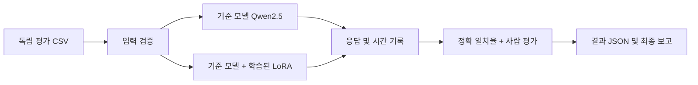

# 📘 12차시 — 파인튜닝 모델 최종 평가 (60분)

## 01 | 표지·목표·60분 진행순서

# 12차시: 파인튜닝 모델 최종 평가

**교육시간:** 60분 | **환경:** Ubuntu, Python 3.11, VS Code | **제작 선택 모델:** `Qwen/Qwen2.5-0.5B-Instruct`

**완료 목표**: 06차시의 학습 전후 비교를 확장하여 기준 모델과 09차시 LoRA 학습 모델의 응답을 같은 조건으로 평가한다. 11차시의 GGUF/Ollama 배포본은 별도 확장 평가 대상으로 구분한다.

**시간표**: 0~10분 평가 설계 → 10~20분 데이터 검증 → 20~35분 추론 실행 또는 DRY RUN → 35~45분 결과 계산 → 45~55분 오류·재현성 점검 → 55~60분 제출.

**최종 산출물**: 평가 CSV, 실행 코드, 결과 JSON, 모델별 비교표, 한계 기록. 실제 학습·추론을 실행하지 않았다면 측정값을 만들지 않는다.

---

## 02 | 배경과 선수지식

## 평가가 필요한 이유

SFT(Supervised Fine-Tuning, 지도 미세조정)는 훈련 손실을 낮출 수 있지만, 이것만으로 새로운 질문에 대한 응답 품질이 향상되었다고 말할 수 없다. 훈련 데이터가 아닌 별도의 평가셋을 사용해야 한다.

**연결 차시**: 06 기준 모델과 어댑터 비교 → 07 학습/검증 데이터 분리 → 08 전체 매개변수 학습 → 09 SFT+LoRA → 10 QLoRA → 11 모델 병합·배포 → 12 최종 평가.

**선수 확인**: `train.jsonl`과 `validation.jsonl`의 용도를 설명할 수 있어야 한다. 09차시의 `adapter_config.json`은 실제 학습을 마친 어댑터의 존재 여부를 확인하는 핵심 파일이다.

**평가의 경계**: 이번 예제는 교육용 5문항이며 통계적으로 유의한 모델 성능 결론을 내릴 수 없다. 실무 평가에서는 도메인별 수십~수백 개 이상과 사람 평가를 추가한다.

---

## 03 | 핵심 원리·지표

## 동일 조건 비교

평가셋, 모델 입력 템플릿, 생성 길이, 샘플링 정책, 실행 장비, 측정 구간을 가능한 한 동일하게 한다. `max_new_tokens=64`, `do_sample=False`는 이번 교안의 제작 선택이다.

**Exact Match(이그잭트 매치, 정답 문자열 정확 일치)**: 정규화된 응답과 기준 답안이 동일한 비율. 계산식은 `일치 문항 수 / 전체 문항 수`이다. 문장형 답변에서는 동의어·표현 차이를 오답으로 판정할 수 있으므로 참고 지표로만 사용한다.

**Latency(레이턴시, 응답 지연시간)**: 질문별 생성에 소요된 시간. 첫 실행의 모델 로딩 및 워밍업 비용은 별도 관리한다. CPU/GPU, 배치 크기, 양자화 방식이 다르면 직접 비교하지 않는다.

**사람 평가**: 정확성·근거성·유해성·형식 준수에 각각 0~2점을 부여하고 평가 근거를 기록한다. 평가자간 일치도와 평가 기준의 고정이 중요하다.

---

## 04 | 시스템 구조도·흐름

## 구조도



**배포본 확장 평가**: 11차시 Ollama 등록 모델을 추가할 때는 API·템플릿·샘플링·양자화 차이를 기록한다. 배포본의 품질 차이는 학습 효과뿐 아니라 변환·양자화의 영향일 수 있다.

**누출 차단**: 평가 질문과 훈련 질문의 문자열 중복 검사뿐 아니라 의미적으로 동일한 문항도 수동 점검한다. 중복 발견 시 학습/평가 분리부터 다시 수행한다.

---

## 05 | 준비·설치·폴더

## Ubuntu 터미널 실습

```bash
# 1. 작업 폴더로 이동: 12차시 파일을 같은 폴더에 둔다
cd 12_최종평가
# 2. 가상환경 생성: Python 패키지 충돌 방지
python3.11 -m venv .venv
# 3. 가상환경 활성화: 이 터미널에서만 적용
source .venv/bin/activate
# 4. 패키지 설치: 실제 모델 실행 시 필요
python -m pip install -U pip
python -m pip install torch transformers peft accelerate
# 5. 데이터만 검사: 모델 다운로드가 발생하지 않는다
python lesson12_evaluate.py
```

**예상 출력**: `DRY RUN PASS: 5개 평가 문항 확인, GPU/모델 실행 없음`.

**주의**: GPU 학습을 재현하려면 CUDA 호환 PyTorch 빌드와 드라이버를 별도로 점검한다. `pip` 설치 명령만으로 GPU 지원을 보장하지 않는다.

---

## 06 | 예제 코드·입출력

## 핵심 코드 흐름

```python
# CSV를 읽어 질문 중복과 필수 필드를 검증한다.
cases = read_cases(args.data)
# 실제 추론이 아니라면 데이터만 확인하고 종료한다.
if not args.run_models:
    print(f"DRY RUN PASS: {len(cases)}개 평가 문항 확인")
    return
# 학습된 LoRA 어댑터가 없으면 전후 비교를 시작하지 않는다.
if not args.adapter:
    raise ValueError("--adapter 경로가 필요합니다")
```

실습 전체 코드는 별도 파일 `lesson12_evaluate.py`에 있다. 해당 파일의 `load_hf()`는 Hugging Face 모델을 불러오고 `generate_hf()`는 `apply_chat_template()`로 채팅 입력을 구성한다.

**결과 파일**: `lesson12_results.json`에 모델별 응답, 기준 답안, 정확 일치, 시간, 평균값을 저장한다. 개인 정보나 API 토큰을 평가 데이터에 포함하지 않는다.

---

## 07 | 코드 해설·검증

## 주요 함수 확인

`read_cases()`는 `question`, `reference` 필수 필드를 검사하고 동일 질문을 차단한다. `score_exact()`는 공백·대소문자를 정규화하지만 의미가 같은 다른 표현을 처리하지 못한다.

`load_hf()`는 기본 모델을 불러오며 어댑터가 지정되면 `PeftModel.from_pretrained()`를 호출한다. `adapter_config.json`이 없는 경로는 학습 완료로 간주하지 않는다.

`generate_hf()`는 `tokenizer.apply_chat_template(..., add_generation_prompt=True)`로 추론 입력을 만들고, 생성된 토큰만 디코딩한다. `torch.inference_mode()`로 불필요한 기울기 계산을 피한다.

`summary()`는 정확 일치율과 평균 시간을 산출한다. 정확 일치율이 0%여도 반드시 모델 성능이 0이라는 뜻은 아니다. 응답을 직접 읽고 별도 기준으로 채점한다.

**실제 확인**: Python 구문 검사, 단위 테스트 3개, DRY RUN 데이터 검증 통과. **미확인**: GPU 모델 로딩, 어댑터 병합, 실제 추론 정확도.

---

## 08 | 따라하기 실습

## 60분 실습 핵심 순서

**1단계 (5분)** `lesson12_eval.csv`를 열어 5개 질문·정답·분류를 확인한다. 07차시 훈련 데이터와 중복되는지 수동 비교한다.

**2단계 (5분)** `python -m unittest -v test_lesson12`를 실행한다. 기대 결과는 `Ran 3 tests ... OK`이다.

**3단계 (5분)** `python lesson12_evaluate.py`를 실행해 데이터 검증만 수행한다.

**4단계 (선택, GPU·학습 어댑터 보유 시 15분 이상)** `python lesson12_evaluate.py --run-models --adapter ../09_SFT_LoRA/<실제_어댑터_경로> --output results.json`을 실행한다. 꺾쇠 경로는 실제 경로로 교체한다.

**5단계 (10분)** JSON의 `base`와 `lora`를 비교한다. 5개 문항의 결과를 일반화하지 않고, 오류 사례를 최소 2개 기록한다.

**6단계 (5분)** 결과 보고서에 환경·모델·어댑터·생성 조건·실행 여부를 기입한다.

---

## 09 | 오류 대처·확장실습

## 자주 발생하는 오류

**`FileNotFoundError: adapter_config.json`**: 학습되지 않은 폴더 또는 잘못된 경로. 09/10차시 학습 산출물을 확인한다. 빈 어댑터를 임의 생성하여 비교하지 않는다.

**CUDA out of memory(쿠다 아웃 오브 메모리, GPU 메모리 부족)**: 다른 프로세스 점검, 모델 크기 축소, 양자화 설정 검토. 단, 4비트 모델과 비양자화 모델의 시간·품질을 동일 조건으로 단정하지 않는다.

**`ModuleNotFoundError`**: 가상환경 활성화와 설치 명령을 확인한다. `python -m pip show transformers peft torch`로 설치 버전을 기록한다.

**정확 일치율이 낮음**: 정답 표현이 다양할 수 있으므로 사람 평가를 추가한다. 정답을 임의로 모델 출력에 맞추지 않는다.

**확장 과제**: 11차시 GGUF/Ollama 배포본을 세 번째 모델로 평가한다. `temperature=0`, 동일 질문과 최대 토큰 수를 맞추되 토크나이저·런타임 차이를 기록한다.

---

## 10 | 평가 체크리스트·공식 출처

## 최종 제출 체크리스트

- [ ] 평가셋이 훈련 데이터와 분리되었는가?
- [ ] 기준 모델과 학습된 LoRA 어댑터의 출처가 확인되는가?
- [ ] 동일한 질문·프롬프트·생성 조건을 사용했는가?
- [ ] DRY RUN과 실제 GPU 추론 결과를 구분했는가?
- [ ] 정확 일치의 한계와 사람 평가의 필요성을 설명했는가?
- [ ] JSON·코드·환경 버전을 제출했는가?

**평가 기준(100점)**: 데이터 독립성 20, 재현성 20, 코드 실행/검증 20, 정량·정성 분석 25, 한계·윤리 기록 15.

**공식 자료 (확인일: 2026-11-05)**

1. Hugging Face Transformers Chat Templates — https://huggingface.co/docs/transformers/main/chat_templating
2. Hugging Face PEFT Model Merging — https://huggingface.co/docs/peft/developer_guides/model_merging
3. Hugging Face Evaluate — https://huggingface.co/docs/evaluate/index

**검증 상태**: 정적 구문·단위 테스트·DRY RUN은 실제 실행. GPU 학습·추론·Ollama 배포 성능은 미검증. 실제 점수와 응답 예시는 생성하지 않았다.


---

## 적대적 검증·개선 기록 (2026-11-05)

- **반영:** 모델의 dtype 인자를 최신 형식으로 수정하고 GPU 측정의 시작 전 동기화를 추가했습니다.
- **검증 구분:** 코드 구문·입력 데이터·PDF 및 HTML 생성과 검증은 수행했으나 실제 모델 다운로드·GPU 학습·추론 품질·Ollama 배포는 별도의 실물 검증이 필요합니다.
- **재현성:** 교육용 5스텝 학습의 손실 감소나 정확도 향상을 보장하지 않습니다. 모델 ID, 데이터 버전, 장치·패키지 버전, 난수 시드, 생성 설정을 기록해야 합니다.
- **공식 근거:** [SFTTrainer](https://huggingface.co/docs/trl/sft_trainer), [PEFT 연동](https://huggingface.co/docs/trl/peft_integration), [템플릿](https://huggingface.co/docs/transformers/main/chat_templating), [PEFT 모델 저장](https://huggingface.co/docs/peft/main/developer_guides/checkpoint), [양자화](https://huggingface.co/docs/transformers/quantization/bitsandbytes), [Ollama GGUF](https://docs.ollama.com/import) (2026-11-05 확인)